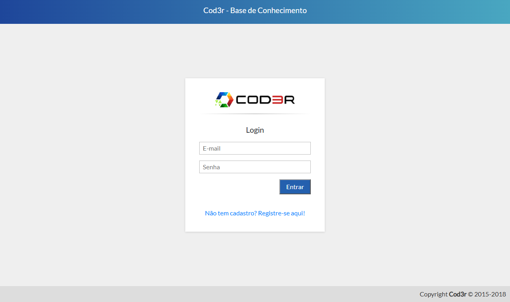
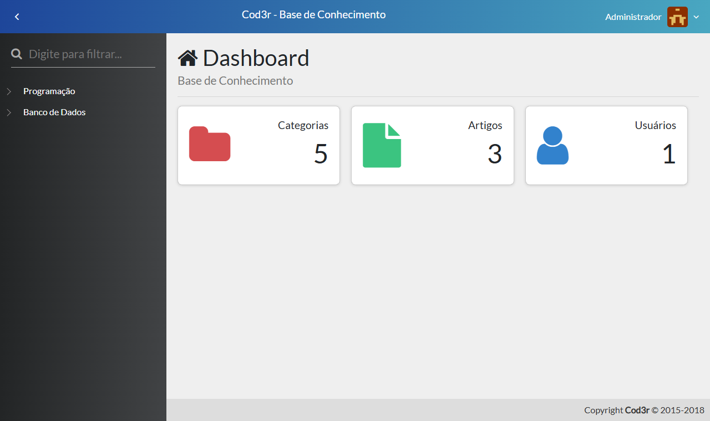
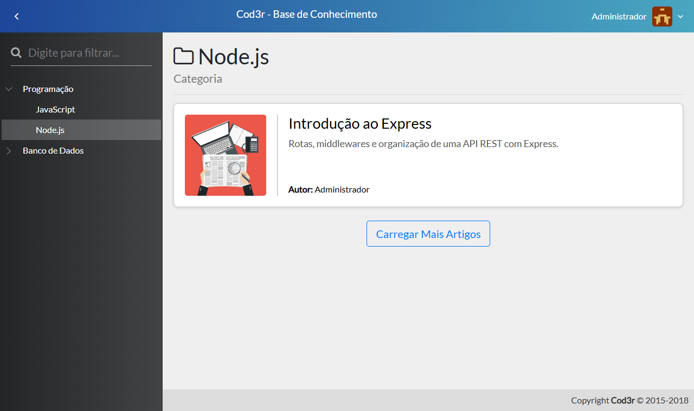
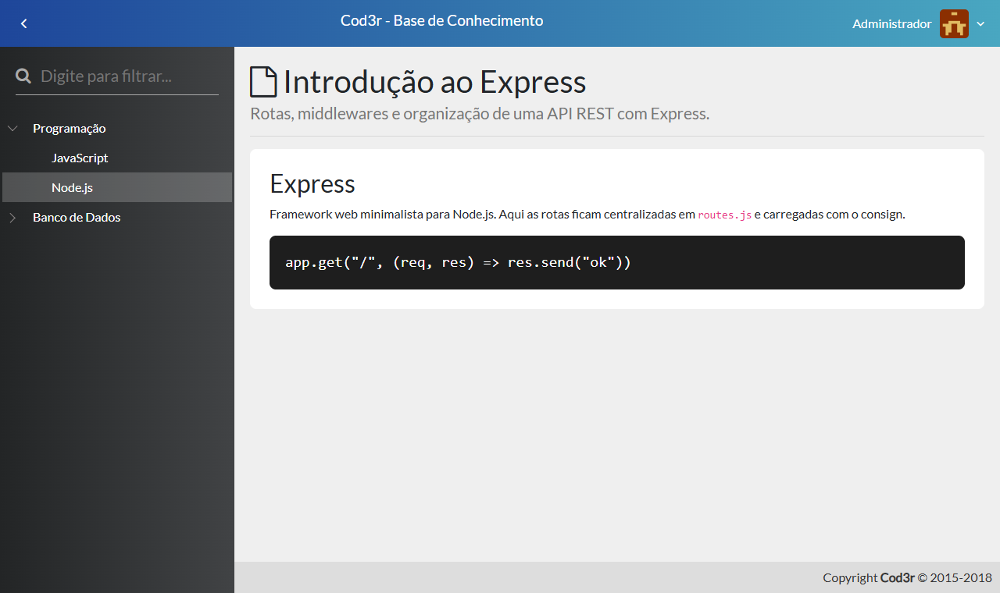
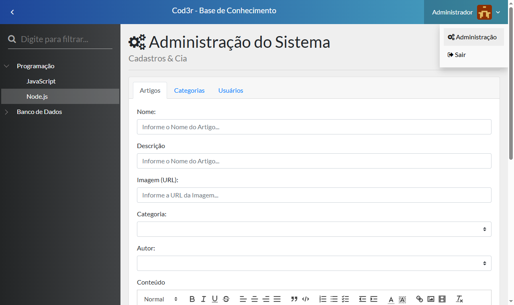
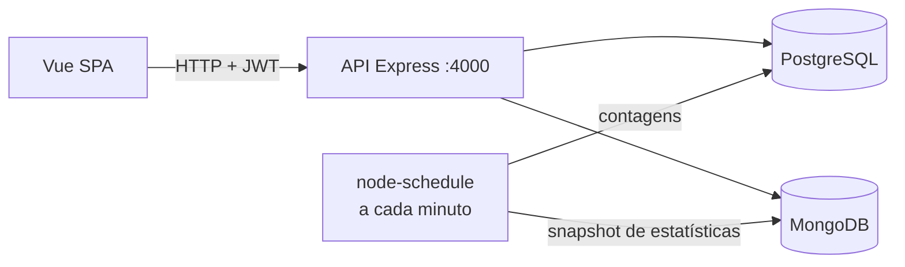

# Base de Conhecimento

Aplicação web full-stack para cadastrar e consultar artigos organizados em categorias (em árvore), com login, painel de administração e dashboard de estatísticas.

> **Projeto de estudo.** Foi desenvolvido durante o curso [Curso Web](https://www.udemy.com/course/curso-web/) da Udemy (Cod3r), acompanhando as aulas como prática de JavaScript, Node.js e Vue. A arquitetura, o escopo e a identidade visual (incluindo o nome "Cod3r" no cabeçalho e rodapé) vêm do curso; o que é meu aqui é a execução, a organização do repositório, esta documentação e a adaptação do código para rodar em versões atuais do Node e dos bancos (ver [Decisões técnicas](#decisões-técnicas)). Não é um produto original nem está em produção.

## Demonstração

| Login | Dashboard |
|---|---|
|  |  |

| Artigos de uma categoria | Leitura de um artigo |
|---|---|
|  |  |



Capturas feitas com o app rodando localmente, com dados de exemplo criados por mim.

## Stack

- **Front-end:** Vue 2, Vue Router, Vuex, Bootstrap-Vue, Axios, vue2-editor
- **Back-end:** Node.js, Express, Passport (JWT), Knex, consign, node-schedule
- **Bancos:** PostgreSQL (usuários, categorias, artigos) e MongoDB via Mongoose (histórico de estatísticas)

## Arquitetura



O front-end consome a API REST. A autenticação usa JWT (Passport); rotas de cadastro exigem usuário administrador. Uma rotina agendada conta usuários, categorias e artigos no Postgres e grava um snapshot no MongoDB quando algo muda; o dashboard lê o último.

## Estrutura de pastas

```
.
├── src/
│   ├── backend/
│   │   ├── api/          # regras de negócio (usuários, categorias, artigos, auth, stats)
│   │   ├── config/       # rotas, middlewares, passport, conexões
│   │   ├── migrations/   # schema do Postgres (Knex)
│   │   ├── schedule/     # rotina de estatísticas
│   │   ├── .env.example  # modelo do arquivo de configuração
│   │   └── index.js
│   └── frontend/
│       ├── public/
│       └── src/          # componentes, rotas, store, config
├── assets/readme/        # capturas de tela
├── LICENSE
└── README.md
```

## Como rodar

Pré-requisitos: Node.js, PostgreSQL e MongoDB rodando localmente.

1. Crie um banco vazio no PostgreSQL (as tabelas são criadas pelas migrations ao subir a API).
2. Configure o back-end: copie `src/backend/.env.example` para `src/backend/.env` e preencha `authSecret` e os dados do Postgres. O arquivo `.env` é ignorado pelo git.
3. Suba a API (porta 4000; usa o MongoDB em `mongodb://localhost/knowledge_stats`):

```powershell
cd src/backend
npm install
npm start
```

4. Suba o front-end:

```powershell
cd src/frontend
npm install
npm run serve
```

5. Crie um usuário pela tela de cadastro. O primeiro administrador precisa ser promovido direto no banco (`update users set admin = true`), pois o cadastro público sempre cria usuários comuns.

> As dependências são de 2018 (versões fixas, escolhidas no curso). Em Node recente, o front pode precisar de `NODE_OPTIONS=--openssl-legacy-provider`, o `pg` 7 não conecta (use `pg@8`) e o `mongoose` 5.2 não funciona com MongoDB moderno (use `mongoose@5.13`). Detalhes abaixo.

## Testes

O projeto não possui testes automatizados.

## Decisões técnicas

- **Duas aplicações separadas** (`backend` e `frontend`), cada uma com seu `package.json`, comunicando-se só por HTTP.
- **Dois bancos com papéis distintos:** Postgres para dados relacionais (categorias em árvore via `parentId`), MongoDB para séries de estatísticas.
- **Migrations com Knex** executadas automaticamente na inicialização da API.
- **Controle de acesso:** middleware `admin` envolve as rotas de escrita; leitura de artigos e da árvore de categorias exige apenas login.
- **Segredos fora do repositório:** `.env` ignorado; só o modelo `.env.example` é versionado.
- **Compatibilidade verificada na prática:** para rodar e capturar as telas em Node 24, precisei de `pg@8`, `mongoose@5.13` e o `--openssl-legacy-provider` no build do Vue. O servidor de desenvolvimento do Vue CLI 3 não iniciou em Node 24, então usei o build estático. Essas atualizações não estão aplicadas no `package.json`, que mantém as versões do curso.

## Roadmap

- Atualizar dependências (`pg`, `mongoose`, Vue CLI) e aplicar no `package.json`
- Mover a URL da API para variável de ambiente
- Seed inicial com um usuário administrador
- Testes automatizados da API
